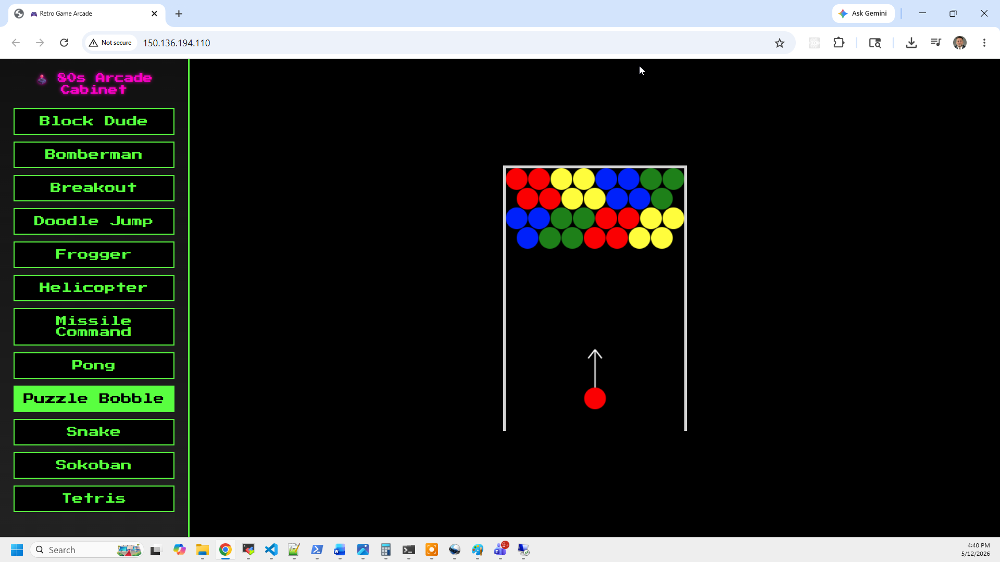
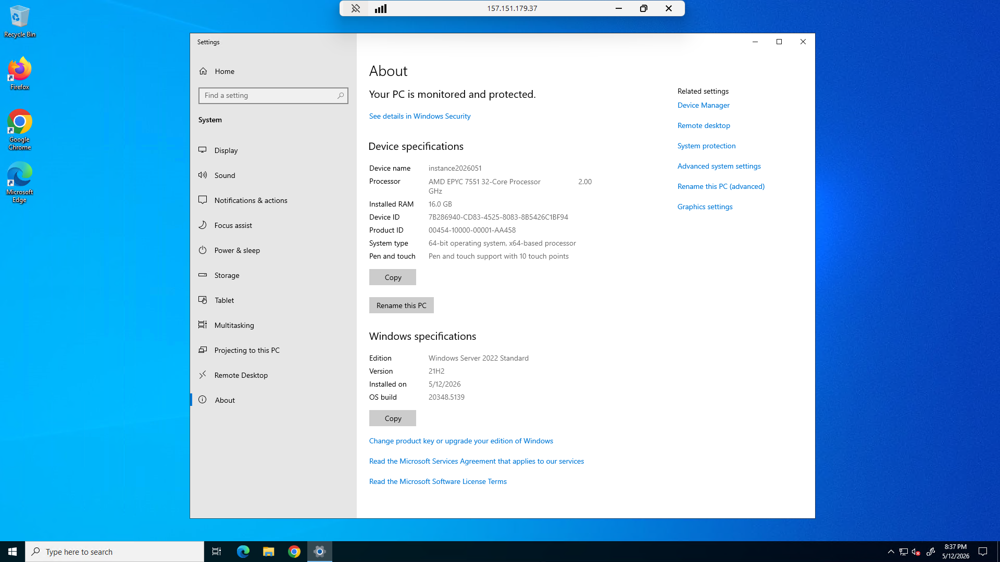

# Building Custom Images with Packer on OCI

Two OCI custom images built with **Packer** and deployed with **Terraform**:
a Linux **games** image, Ubuntu 24.04 with Apache serving a dozen retro HTML
games, and a Windows **desktop** image, Windows Server 2022 with Chrome and
Firefox. Both images carry a local `packer` account whose password Terraform
generates, and Terraform launches one instance from each. The Windows half is
optional.

[](https://www.youtube.com/watch?v=ZV-3l1yIwrw)

| Piece | Where | Role |
|---|---|---|
| **games_image** | custom image | Ubuntu 24.04 + Apache + 12 HTML games, `packer` sudo user |
| **desktop_image** | custom image | Windows Server 2022 Standard + Chrome, Firefox, `packer` admin user; cloudbase-init reset so each instance initializes fresh |
| **games-server** | `packer-subnet` | `VM.Standard.E2.1.Micro` (Always Free eligible) from the newest games image; public IP |
| **desktop-server** | `packer-subnet` | `VM.Standard.E2.2` from the newest desktop image; public IP; only when `BUILD_WINDOWS=true` |
| **Terraform state** | `01-infrastructure/terraform.tfstate` | the `packer` password as a sensitive output, and the generated SSH key; OCI Vault isn't used |

## Architecture

<picture>
  <source media="(prefers-color-scheme: dark)" srcset="architecture-dark.svg">
  
</picture>

Regenerate with `python3 make_diagram.py`.

- **`01-infrastructure/`**: the VCN (`packer-vcn`, 10.0.0.0/16) with its
  internet gateway, route table, security list and `packer-subnet`
  (10.0.1.0/24); an ECDSA SSH key (`keys/Private_Key`) and the `packer`
  password.
- **`02-packer/linux/`**: `linux_ami.pkr.hcl`, the HTML games, and the
  install and user scripts.
- **`02-packer/windows/`**: `windows_ami.pkr.hcl` and the PowerShell
  provisioners.
- **`03-deploy/`**: the two instances, launched from the newest
  `games_image*` and `desktop_image*` custom images.

## How the images are built

`apply.sh` looks up the newest Ubuntu 24.04 and Windows Server 2022 Standard
platform images and passes them to Packer, which builds in `packer-subnet`.

**Linux** (`VM.Standard.E2.1.Micro` build instance):

1. Waits for IPv4 internet, points apt at `us.archive.ubuntu.com`, and
   installs Apache, which serves the games from `/var/www/html`.
2. Opens port 80 in the image's iptables rules, which block it by default.
3. Creates the `packer` user with the generated password and passwordless
   sudo.

**Windows** (`VM.Standard.E2.2` build instance, WinRM HTTPS on 5986):

1. A cloudbase-init user-data script sets the password of the image's `opc`
   account, which Packer uses to connect over WinRM.
2. Creates the `packer` user in Administrators and Remote Desktop Users,
   installs Chrome and Firefox, and removes the OCI desktop shortcuts.
3. Clears the cloudbase-init logs and sets it to process user data again, so
   each instance from the image initializes like a fresh one.

The template includes the `windows-update` plugin, but the update
provisioner is commented out, so the image is built without running Windows
Update.

## Security list

```
internet ─22, 80, 443, 3389, 5986─▶ packer-subnet (build instances, games-server, desktop-server)
```

`packer-security-list` is attached to the only subnet and allows those five
ports from `0.0.0.0/0`, with all outbound traffic allowed.

## Prerequisites

* [An OCI Account](https://cloud.oracle.com/)
* [Install OCI CLI](https://docs.oracle.com/en-us/iaas/Content/API/SDKDocs/cliinstall.htm)
  and run `oci setup config` (a `DEFAULT` profile in `~/.oci/config`)
* [Install Terraform](https://developer.hashicorp.com/terraform/install)
* [Install Packer](https://developer.hashicorp.com/packer/install)
* [Install jq](https://jqlang.github.io/jq/download/)

## Deploy

```bash
git clone https://github.com/mamonaco1973/oci-packer.git
cd oci-packer
export OCI_COMPARTMENT_ID=<compartment-ocid>   # optional; defaults to the tenancy
./apply.sh       # 1: VCN + key + password  2: games and desktop images (Packer)  3: instances
```

To build and deploy only the Linux half:

```bash
BUILD_WINDOWS=false ./apply.sh
```

Everything deploys to `us-ashburn-1`, in the first availability domain.
`apply.sh` ends by running `validate.sh`:

```
============================================================
 OCI Compute Instance Access Details
============================================================

 Games Server Public IP:
   203.0.113.10
   http://203.0.113.10
   ssh -i ./01-infrastructure/keys/Private_Key ubuntu@203.0.113.10

 Windows Desktop Server Public IP:
   203.0.113.20
   RDP to 203.0.113.20 with user 'packer'
   Run ./get_password.sh to retrieve the packer account password
```

## Try it

1. Open the games URL and pick a game.

   

2. Get the `packer` password:

   ```bash
   ./get_password.sh
   ```

3. RDP to the Windows desktop server as `packer`:

   

## Troubleshooting

| Symptom | Fix |
|---|---|
| The Windows build sits at "Waiting for WinRM" | Windows boot plus cloudbase-init takes a while; the template waits up to 20 minutes. Check that outbound 5986 isn't blocked where you run Packer. |
| The games page times out | Port 80 must be allowed ahead of the image's iptables rules: SSH in and run `sudo iptables -L INPUT -n --line-numbers`. |
| `apply.sh` can't resolve a base image | The compartment must see OCI's platform images; check `OCI_COMPARTMENT_ID`. |
| `destroy.sh` misses the Windows instance | Run it with the same `BUILD_WINDOWS` value you used for `apply.sh`. |

## Teardown

```bash
./destroy.sh     # destroys the instances, deletes the custom images, destroys the network
```

## Notes

- **Lab only.** SSH, HTTP, RDP and WinRM are open to the internet, and the
  `packer` account is an administrator on both images. Restrict
  `packer-security-list` for anything more.
